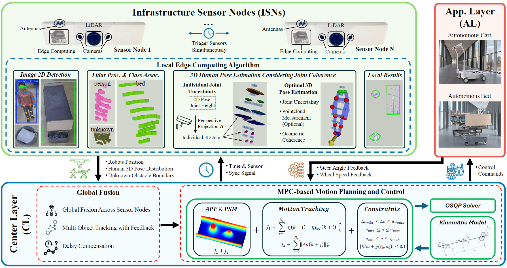
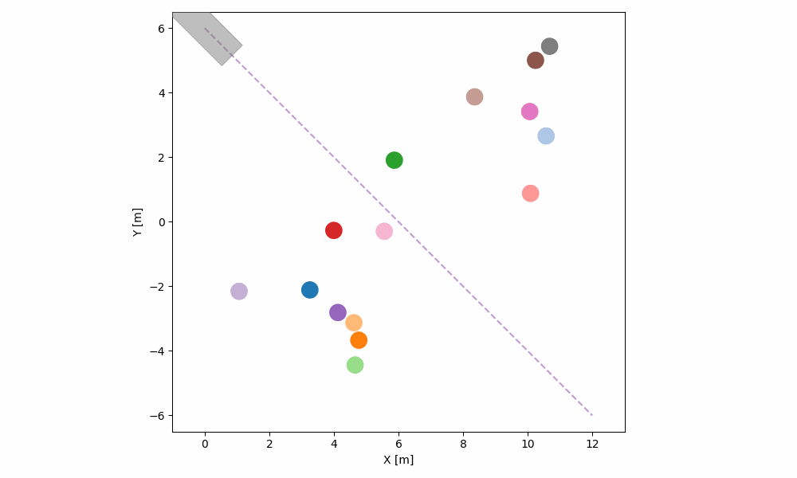

# MVSLab SAP-CoPE Project
Official Repo of "SAP-CoPE: Social-Aware Planning using Cooperative Pose Estimation with Infrastructure Sensor Nodes" 

Authored by Minghao Ning*, Yufeng Yang*, Shucheng Huang, Jiaming Zhong, Keqi Shu, Chen Sun, Ehsan Hashemi and Amir Khajepour. 

\* indicates equal contribution, authors listed in alphabetical order. 

For questions, please get in touch with Yufeng Yang, f248yang@uwaterloo.ca.
## Overall Structure


## Social-aware Motion Planning Simulation Results
<table>
  <caption><b>70th Simulation Results</b></caption>
  <tr>
    <td align="center">
      <br>
      <b>SMF</b>
    </td>
    <td align="center">
      <br>
      <b>SARL</b>
    </td>
  </tr>
  <tr>
    <td align="center">
      <br>
      <b>Conventional</b>
    </td>
    <td align="center">
      <br>
      <b>Proposed (Ours)</b>
    </td>
  </tr>
</table>


<!-- ### Scenario One: Obstacle and Human Interaction -->
<!-- [](https://youtu.be/yXRH-UHOn6I) -->
## Experiments in Paper 


<!-- ## Other Experiments Not Included in Paper
- ### Yielding
[](https://www.youtube.com/watch?v=zujStRe5opY)

- ### Group Interaction
[](https://www.youtube.com/watch?v=mxEISI-pIPE)

 - ### Single Person Interaction
[](https://www.youtube.com/watch?v=-QVE9bT__44)

 - ### Two People Interaction
[](https://www.youtube.com/watch?v=bxoDXpwp38g)

 - ### Yielding 2
[](https://www.youtube.com/watch?v=aMif5f1yLV4)

 - ### Group Interaction 2
[](https://www.youtube.com/watch?v=RbLEu5zwzKo) -->

<!-- ## Citation
If you find this work useful, please consider citing:
```
@article{ning2025SAP,
  title={SAP-CoPE: Social-Aware Planning using Cooperative Pose Estimation with InfrastructureSensor Nodes},
  author={Minghao Ning*, Yufeng Yang*, Shucheng Huang, Jiaming Zhong, Keqi Shu, Chen Sun, Ehsan Hashemi and Amir Khajepour},
}
``` -->
