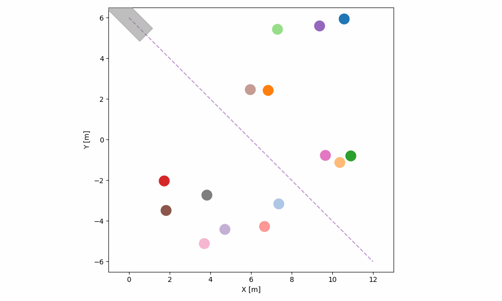

# MVSLab SAP-CoPE Project
Official Repo of "SAP-CoPE: Social-Aware Planning using Cooperative Pose Estimation with Infrastructure Sensor Nodes" 

## Overall Structure

## Social-aware Motion Planning Simulation Results
<table>
  <caption><b>70th Simulation Results</b></caption>
  <tr>
    <td align="center">
       
      <b>SMF</b>
    </td>
    <td align="center">
       
      <b>SARL</b>
    </td>
  </tr>
  <tr>
    <td align="center">
       
      <b>Conventional</b>
    </td>
    <td align="center">
       
      <b>Proposed (Ours)</b>
    </td>
  </tr>
</table>

<table>
  <caption><b>100th Simulation Results</b></caption>
  <tr>
    <td align="center">
       
      <b>SMF</b>
    </td>
    <td align="center">
       
      <b>SARL</b>
    </td>
  </tr>
  <tr>
    <td align="center">
       
      <b>Conventional</b>
    </td>
    <td align="center">
       
      <b>Proposed (Ours)</b>
    </td>
  </tr>
</table>

<!-- ### Scenario One: Obstacle and Human Interaction -->
<!--  -->

## Overall Experiments Video
<table>
  <tr>
    <td align="center" width="50%">
       
      <b>Yielding 2</b>
    </td>
    <td align="center" width="50%">
       
      <b>Group Interaction 2</b>
    </td>
  </tr>
</table>

